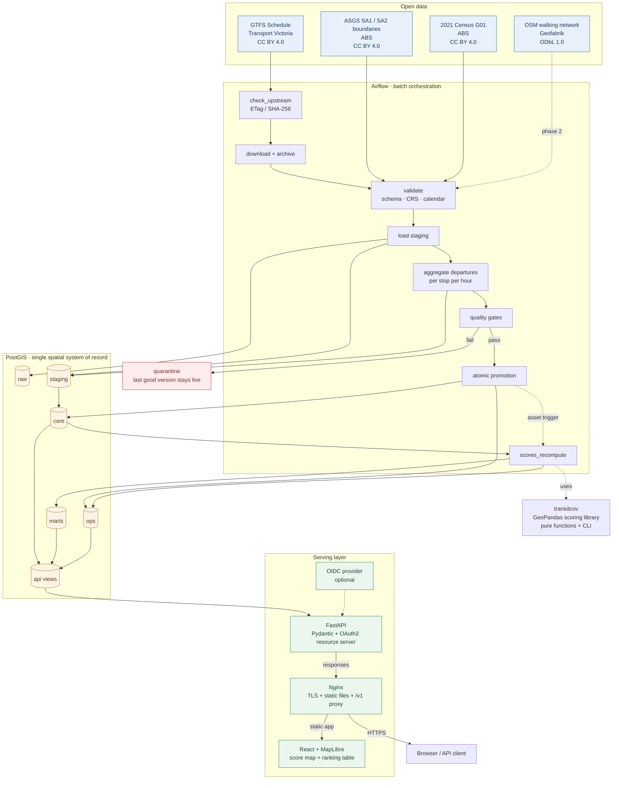

# Transit Coverage Platform

**How well does public transport cover Greater Melbourne?** This project measures, for every Statistical Area Level 1 (SA1) and every ~250 m hex cell, how much scheduled public transport a resident can reach on foot during the morning peak, and publishes the result as an open, reproducible 0–100 score.

The platform is built on open data (GTFS, ABS boundaries, 2021 Census) and open software (PostGIS, GeoPandas, Airflow, FastAPI, React/MapLibre). It is designed to refresh weekly, to keep the last good version live when a data load fails, and to state the feed and model version behind every number it returns.

> **Status (27 October 2026).** The data snapshot is downloaded and profiled; the PostGIS/Airflow Compose scaffold is present. Ingestion DAGs, the `transitcov` scoring library, the API and the web map are still being built. Numbers in this README were measured against the local `data/` snapshot unless stated otherwise.

**Contents**

1. [The problem this project aims to solve](#1-the-problem-this-project-aims-to-solve)
2. [Literature review](#2-literature-review)
3. [Why one framework for spatial work](#3-why-one-framework-for-spatial-work)
4. [The function we compute, and the result it produces](#4-the-function-we-compute-and-the-result-it-produces)
5. [Required input data](#5-required-input-data)
6. [Sources](#6-sources)
7. [System architecture](#7-system-architecture)
8. [Repository layout](#8-repository-layout)
9. [Licence and attribution](#9-licence-and-attribution)

---

## 1. The problem this project aims to solve

### 1.1 The question

A resident, planner or advocate should be able to ask a simple question:

> *For this place, how much scheduled public transport can I actually reach on foot in the morning peak — and how does that compare with the rest of the city?*

Existing tools do not answer it well. A journey planner answers "how do I get from A to B at 08:12?" A stop map answers "where is the nearest stop?" Neither answers "how well served is this neighbourhood, consistently, across the whole city, this week?"

The distinction matters. Two addresses 300 m apart can have very different access: one is near a tram every eight minutes, the other near a bus twice an hour. A stop count treats them the same. A coverage score should not.

### 1.2 Why the question is hard

1. **Proximity is not service.** A stop 200 m away with two departures a day is not meaningful access. Frequency, mode and walking distance interact.
2. **The data is fragmented.** Timetables come as GTFS from Transport Victoria, boundaries and population from the ABS, and the walking network from OpenStreetMap. They arrive in different formats, coordinate reference systems, vintages and update cycles.
3. **The scale is large.** Victoria has 16,092 SA1s in the 2026 geography, Greater Melbourne spans tens of thousands of 250 m cells, and a single bus `stop_times.txt` file is 649 MB. Naive in-memory processing does not fit on a small server.
4. **Comparability is fragile.** A score is only useful if it means the same thing from one weekly run to the next. Changing a parameter, a boundary vintage or a feed silently breaks comparisons.
5. **Averages hide the distribution.** A citywide mean can look acceptable while specific communities have no frequent service. Equity analysis needs population-weighted tails, not just a headline number.
6. **Provenance is usually missing.** Published maps rarely say which feed, which Census year and which model produced a colour. Without that, a score cannot be audited or reproduced.

### 1.3 What the platform delivers

- A **0–100 coverage score** per SA1 representative point and per ~250 m hex cell, with the contributing stops and their distances.
- **Population-weighted roll-ups** to SA2: share of residents within 400 m and 800 m of a stop, share within a catchment of a frequent service, mean score and the lowest-scoring decile.
- A **weekly refresh** from GTFS, with validation gates and atomic promotion so a failed load never reaches users.
- A **versioned REST API** (FastAPI, GeoJSON, OAuth2 resource server) and a small **web map** (React + MapLibre).
- An **installable Python library**, `transitcov`, containing the scoring and GTFS logic as pure, testable functions.
- **Provenance by default**: every response states feed version, fetch date, model version and licence.

### 1.4 Non-goals

- Journey planning or routing between two places.
- Live passenger information; GTFS Realtime is an optional later layer.
- Statewide regional accuracy in version 1; the design is extensible but the study area is Greater Melbourne.
- Personal data, payments or multi-tenant accounts. Every input is public open data.
- A normative judgement that a place is "good" or "bad". The score describes scheduled supply; it does not measure whether that supply is sufficient for a particular household.

---

## 2. Literature review

This is a selected review of the literature that shaped the design, not a systematic review. The aim is to justify the choice of measure, the unit of analysis and the output metrics.

### 2.1 Accessibility, not mobility

Hansen (1959) framed accessibility as the potential for interaction, with the value of an opportunity discounted by the distance needed to reach it. Handy and Niemeier (1997) reviewed the family of operational measures — cumulative opportunity, gravity, utility-based — and showed that the choice depends on the planning question rather than on a single correct formula. Páez, Scott and Morency (2012) drew a useful distinction between *positive* measures, which describe observed conditions, and *normative* measures, which evaluate those conditions against a standard.

This project computes a **positive, place-based measure in the cumulative-opportunity tradition**: it counts service opportunities inside a catchment and discounts them by distance. It describes the scheduled service reachable from a place; it does not claim that the level is adequate. That distinction controls the language of the output: the result is a coverage score, not a verdict.

### 2.2 Coverage and frequency indices

The best-known operational index is **PTAL** (Public Transport Accessibility Level), developed by Transport for London and applied outside London by Wu and Hine (2003). PTAL combines walking access time to stops with service frequency converted into average waiting time, then aggregates to an accessibility band. Its enduring lesson is that frequency and walk time must enter the measure together; a dense grid of infrequent stops does not produce good access.

Australian work adapts the idea to local conditions. Saghapour, Moridpour and Thompson (2016) developed a public transport accessibility index for metropolitan Melbourne that incorporates population density, and Currie (2010) quantified spatial gaps in public transport supply against social need. These studies support three design choices used here: mode-specific catchments, a frequency term rather than a stop count, and population weighting in the aggregation.

The project departs from PTAL in its presentation. PTAL reports a discrete accessibility band, which is useful for planning thresholds but hides small changes inside a band. This project keeps a continuous score on a fixed saturating curve with frozen calibration, so incremental change remains visible and a score in one weekly run is comparable with the same score in the next.

### 2.3 Equity and social need

Transport disadvantage is not evenly distributed. Lucas (2012) reviews the mechanisms linking transport and social exclusion; Currie (2010) and Scheurer, Curtis and McLeod (2017) show that Australian cities contain spatially concentrated accessibility gaps that coincide with socioeconomic disadvantage. Foth, Manaugh and El-Geneidy (2013) and El-Geneidy et al. (2016) find analogous patterns in Canadian case studies using accessibility and total travel cost. Allen and Farber (2019) scale the question to a national accounting of transport poverty, and Pereira, Schwanen and Banister (2017) and Martens (2016) set out the distributive-justice framing that makes the question political rather than merely technical.

The implication for the product is that a single citywide average is not enough. The platform therefore reports population-weighted means, shares of residents within catchments, and the lowest-scoring decile, and it avoids ranking areas as "good" or "bad" without context. The equity analysis is descriptive: it identifies where supply is thin, not who deserves investment.

### 2.4 GTFS and fine-grained measurement

GTFS makes scheduled service machine-readable at stop and trip level, so coverage can be recomputed whenever the timetable changes. Tribby and Zandbergen (2012) demonstrated high-resolution spatio-temporal modelling of transit accessibility from GTFS; Mavoa et al. (2012) combined transit and walking for destination access in Auckland; and Owen and Levinson (2015) showed that continuous transit accessibility to jobs is associated with commute mode share. These results support GTFS as the right input and a defined time window as the right unit of analysis.

They also expose the main cost: true access depends on network travel time, not straight-line distance. Version 1 uses straight-line distance in a metric CRS and states that limitation. The distance function is isolated behind a single interface, so a network engine (r5py, pandana, pgRouting or a custom OSM graph) can replace it without changing the scoring formula.

### 2.5 Spatial support and the hex grid

SA1s are the finest published Census geography with full population counts, which makes them the natural unit for population statistics. They are not, however, uniform in size or shape: large fringe SA1s blur internal variation, and irregular polygons make visual comparison difficult. A regular hex grid reduces the orientation bias and edge effects of a square grid because each cell has six equidistant neighbours (Birch, Oom & Beecham, 2007).

The platform therefore uses **two spatial supports on purpose**: SA1s for population-weighted statistics, and ~250 m hexagons for the map. Population on a hex cell is an area-weighted share of its SA1, which is exact only under uniform density. That approximation is documented rather than hidden.

### 2.6 The gap this project fills

Most published accessibility studies are one-off analyses with bespoke code and data extracts. Operational tools such as PTAL and journey planners answer adjacent but different questions. Few open projects combine all of the following: weekly GTFS refresh, Census population, a transparent and parameterised model, dual-resolution outputs, a versioned API with provenance, and a reusable library.

The contribution here is therefore **engineering and reproducibility**, not a new theory of accessibility. The model is deliberately simple enough to audit; the value lies in running it end to end, on open data, with tests and failure handling.

| Literature | Design choice adopted here |
| --- | --- |
| Hansen (1959); Handy & Niemeier (1997); Páez et al. (2012) | A positive, place-based cumulative-opportunity measure with distance decay; results described as coverage, not adequacy |
| Wu & Hine (2003); Transport for London (2015) | Frequency and walking distance enter together; mode-specific catchments |
| Saghapour et al. (2016); Currie (2010) | Melbourne-specific calibration assumptions; population-weighted aggregation |
| Lucas (2012); Foth et al. (2013); El-Geneidy et al. (2016); Allen & Farber (2019) | Report distribution and tails, not only means; avoid normative labels |
| Tribby & Zandbergen (2012); Mavoa et al. (2012); Owen & Levinson (2015) | GTFS as input; a fixed peak window; isolate the distance function for a later network upgrade |
| Birch et al. (2007) | Hexagonal display grid; SA1 for population statistics |
| Walker (2012) | Treat frequency, not coverage of the map, as the core service attribute |

---

## 3. Why one framework for spatial work

### 3.1 The decision

The project uses **one spatial system of record: PostGIS**. GeoPandas and Shapely are used as the in-process client for the scoring model, not as a second store.

In practice:

- **PostGIS** owns every authoritative geometry, every spatial index, every distance and area calculation used for published results, the hex grid, and the vector tiles.
- **GeoPandas** reads a snapshot of stops, origins and boundaries for the scoring function, so the model can run in a test, a notebook or a CLI without a database.
- The API **never** recomputes authoritative geometry. It reads views that filter on the active feed and model version.

This is one framework with two runtimes. There is no second spatial database, no shapefile passed between pipeline stages, and no client-side geometry engine that can disagree with the database.

### 3.2 Invariants that keep it one framework

1. **One geometry authority.** `core.*` and `marts.*` geometry columns are the only published geometries. Derived copies are disposable.
2. **One metric CRS for measurement.** Distances and areas use GDA2020 / VicGrid (EPSG:7899) in metres. WGS84 (EPSG:4326) appears only at the API and map edge, after measurement.
3. **One identifier system.** GTFS `stop_id`, ABS `SA1_CODE`/`SA2_CODE`, `feed_version_id` and `model_run_id` are carried through every layer. Joins are explicit, never positional.
4. **One write path.** Airflow is the only writer to `raw`, `staging`, `core`, `marts` and `ops`. The API connects with a read-only role and a statement timeout.
5. **One promotion switch.** `ops.active_version` names the live feed and model run; the API views filter on it. Publishing and rollback are each a single `UPDATE`.

### 3.3 Why PostGIS is the spatial framework

- **Mature spatial SQL.** `ST_DWithin`, `ST_Distance`, nearest-neighbour ordering with `<->`, `ST_HexagonGrid`, `ST_Intersection`, `ST_AsMVT` and validity checks are built in and well documented (Obe & Hsu, 2021).
- **Indexes that fit the query.** GiST indexes make "stops within 400 m of this point" cheap without loading the state into memory.
- **Transactions and roles.** Atomic promotion, quarantine and a read-only API role are natural database features, not application conventions.
- **One database serves pipeline and API.** The same store holds raw inputs, conformed entities, published marts and metadata, so backup, restore and access control have one story.
- **Open and portable.** It runs in Docker on a laptop and on a small VM; there is no cloud-specific dependency in the core.
- **Tiles without a second service.** `ST_AsMVT` produces vector tiles from the same tables, so the map does not need a separate tile server.

### 3.4 Why GeoPandas still runs the model

- **The formula is small and needs tests.** A pure function over GeoDataFrames is easier to read, review and property-test than a large SQL query.
- **Reuse outside the platform.** The same code powers the library, the CLI and notebooks. This is a stated goal: `transitcov` must not depend on a database or a web framework.
- **Clear separation of concerns.** The model owns the formula and parameters; PostGIS owns storage and set-based spatial operations. If the spatial join becomes the bottleneck, that step can move into SQL without changing the public function signature.
- **Deterministic by construction.** Given the same origins, stops and parameters, the function returns the same scores. That makes golden-file tests possible.

### 3.5 Alternatives considered

| Option | Strengths | Why it is not the primary choice here | Switch when |
| --- | --- | --- | --- |
| **PostGIS + GeoPandas (chosen)** | Transactions, GiST indexes, tiles, one source of truth, local reproducibility | Requires PostGIS operations and CRS discipline; GDAL wheels add install weight | — |
| **DuckDB + spatial extension + GeoParquet** | Very fast embedded analytics; zero-ops; excellent for notebooks | Not a multi-client transactional server; no row-level roles, GiST or `ST_AsMVT`; would force a second engine once the API exists (Raasveldt & Mühleisen, 2019) | The product becomes analytics-only, with no live API |
| **GeoDjango + DRF** | Spatial ORM, admin, mature auth | Couples the model to a heavier web framework; the scoring library must stay framework-free | An admin UI and heavy CRUD become the main requirement |
| **ArcGIS / ArcPy or QGIS-only** | Rich desktop analysis and cartography | Licence cost, manual steps, poor CI reproducibility; not a server-side engine | A licensed enterprise GIS environment is mandated |
| **OSMnx / pandana / r5py / pgRouting** | True network and multimodal travel times | They are routing engines, not stores; graph builds are heavy and version-specific | Straight-line bias is shown to distort rankings; then use one behind the same distance interface |
| **BigQuery GIS / Snowflake** | Elastic scale, managed operations | Cost, cloud lock-in, not runnable locally, harder to keep a one-command demo | The dataset grows far beyond one city and a team owns the cloud account |

### 3.6 Costs, and how they are contained

- **CRS mistakes** are the most common spatial bug. Every load asserts its source CRS, transforms explicitly, and stores both the metric and WGS84 geometry. Tests check a known distance.
- **Invalid geometry** is rejected with `ST_IsValid` before it reaches a published table.
- **Memory pressure** is handled by streaming `stop_times.txt` in chunks and storing only hourly aggregates, not raw stop times.
- **Operational weight** is contained by Docker Compose profiles: `core` runs the database, API and web app; `pipeline` adds Airflow; `auth` adds the optional identity provider.

---

## 4. The function we compute, and the result it produces

### 4.1 What the function must do

The scoring function must:

1. Take a set of origins (SA1 representative points or hex cell centres), a set of stops with scheduled frequency, and an explicit parameter object.
2. Restrict each origin to stops inside a mode-specific catchment.
3. Combine frequency, mode and distance into a single contribution per stop.
4. Return a bounded score in `[0, 100]` plus the intermediate values needed to explain it.
5. Be deterministic, order-independent and cheap enough to score every origin in Greater Melbourne in one batch.
6. Carry the model version and parameter set with every output row.

### 4.2 Inputs and symbols

| Symbol | Meaning |
| --- | --- |
| `i` | Origin: an SA1 representative point or a hex cell centre |
| `s` | A stop–mode pair inside the catchment of `i` |
| `d_is` | Walking distance in metres from `i` to `s` (straight-line in v1) |
| `f_s` | Scheduled departures per hour at `s` in the analysis window |
| `m(s)` | Mode of `s`: rail, tram, bus or coach |
| `R_m` | Catchment radius for mode `m` |
| `w_m` | Mode weight |
| `f_cap` | Frequency cap (departures per hour) |
| `β_m` | Distance-decay rate for mode `m` |
| `k` | Calibration constant that sets how quickly the score saturates |

### 4.3 Service frequency

For each stop and mode, count `pickup_type = 0` departures whose `departure_time` falls inside the window (07:00–09:00 on a typical weekday) and divide by the window length in hours. GTFS times may exceed `24:00:00` for after-midnight service, so times are parsed as durations, not clock times. Platforms under the same `parent_station` are merged per mode; replacement-bus stops (`R-Bus`) are excluded.

Frequency is capped at `f_cap` because the marginal value of a departure falls sharply once waiting time is short: beyond a bus every five minutes, the tenth extra departure matters little to the score.

### 4.4 Catchment and decay

A stop contributes only if `d_is ≤ R_m`. Within the catchment, its weight decays exponentially:

$$\beta_m = \frac{\ln 2}{R_m/2}$$

so a stop at half the catchment radius carries half the weight of a stop at the origin, and a stop at the boundary carries one quarter. The hard cut at `R_m` creates a small discontinuity; a smooth cutoff is a candidate for a later model version and is listed as a known limit.

### 4.5 The scoring function

$$A_i = \sum_{s \in S_i} w_{m(s)} \cdot \min(f_s, f_{cap}) \cdot e^{-\beta_{m(s)} d_{is}}$$

$$\text{score}_i = 100 \left(1 - e^{-A_i / k}\right)$$

`A_i` is the total weighted, distance-decayed service available at origin `i`. The outer curve is strictly increasing and saturating: the first services move the score quickly, later ones add less, and the result can never exceed 100. Because `k` is fixed after calibration, a given `A_i` always maps to the same score, which is what makes weekly comparisons meaningful.

### 4.6 Starting parameters

These are explicit assumptions to calibrate and publish, not empirical facts.

| Parameter | Starting value | Reasoning | Status |
| --- | --- | --- | --- |
| `R_rail` | 800 m | Common planning rule of thumb for rail access | Assumption |
| `R_tram`, `R_bus` | 400 m | Common planning rule of thumb for street-level access | Assumption |
| `w_m` | 1.0 for every mode | Neutral until a sensitivity run justifies otherwise | Assumption |
| `f_cap` | 12 departures/hour | Beyond a five-minute headway, waiting time barely changes | Assumption |
| `k` | 5.0 | Sets a readable scale; frozen after the first full run | To calibrate once |
| Window | 07:00–09:00 weekday | Peak commuting service | Assumption |
| Distance | Straight-line, EPSG:7899 | Fast, testable, no extra data | Known limitation |
| Grid | ~250 m hexagons | Readable at city scale; ~0.05 km² per cell | Assumption |

### 4.7 Worked example

One tram stop with `f = 6` departures per hour, `R = 400 m`, `w = 1.0`, `k = 5.0`. Then `β = ln 2 / 200 = 0.003466 m⁻¹`.

| Origin | Distance | In catchment? | `A_i` | Score |
| --- | --- | --- | --- | --- |
| O1 | 0 m | Yes | 6.00 | 69.9 |
| O2 | 200 m | Yes | 3.00 | 45.1 |
| O3 | 400 m | Yes (boundary) | 1.50 | 25.9 |
| O4 | 500 m | No | 0.00 | 0.0 |

The table shows the intended behaviour: frequency is worth something, distance erodes it, and the score saturates rather than growing without bound. It also shows the boundary discontinuity: a stop at 401 m contributes nothing, while one at 400 m still contributes a quarter of its weight. The next model version should replace the hard cutoff with a smooth kernel.

### 4.8 The result

**Per-cell result** (`marts.score_cell`):

| Field | Meaning |
| --- | --- |
| `model_run_id` | Identifies the parameter set and run |
| `cell_id` | Hex cell identifier |
| `population` | Area-weighted share of the containing SA1 |
| `score` | 0–100 coverage score |
| `stops_400m` | Number of stop–mode pairs within 400 m |
| `peak_deps_hr` | Departures per hour in the window, aggregated over contributing stops |
| `geom`, `geom_4326` | Cell geometry in EPSG:7899 and EPSG:4326 |

**Per-area result** (`marts.score_sa1`, `marts.coverage_sa2`):

| Metric | Meaning |
| --- | --- |
| `mean_score` | Population-weighted mean of cell scores in the area |
| `pct_within_400m` | Share of residents within 400 m of any stop |
| `pct_within_800m` | Share of residents within 800 m of any stop |
| `pct_frequent` | Share within a catchment of a service with ≥ 4 departures/hour |
| `p10_score` | Population-weighted 10th percentile; the lowest-scoring decile |

**API shape** (`GET /v1/coverage/point?lat=…&lon=…`). The values below are illustrative, not a measured result:

```json
{
  "type": "Feature",
  "geometry": { "type": "Point", "coordinates": [144.9631, -37.8136] },
  "properties": {
    "score": 71.4,
    "window": "weekday_0700_0900",
    "peak_departures_per_hour": 14.0,
    "stops_in_catchment": [
      { "stop_id": "…", "name": "…", "mode": "tram", "distance_m": 180 }
    ]
  },
  "meta": {
    "feed_version": "…",
    "model_version": "1.0.0",
    "attribution": "Transport Victoria, ABS, © OpenStreetMap contributors"
  }
}
```

The map exposes the same result twice: as a coloured hex layer for reading the city at a glance, and as a sortable area table that gives the same information without relying on colour.

### 4.9 How to read a result

- **0** means no scheduled service inside any mode catchment during the window. It does not mean no transport at other times, and it does not mean the place is inaccessible by car.
- **100** means a saturating level of frequent service across the catchment. It is rare and should not be read as a service-quality guarantee.
- **Compare within a model run, not across model versions.** A parameter change bumps the model version; scores from different versions are not directly comparable.
- **The score is supply, not demand.** It does not account for crowding, reliability, fares, or where the services go.
- **A high mean can hide a low tail.** Read `p10_score` and the catchment shares alongside the mean.

### 4.10 Validation

- Hand-computed fixtures: one stop and three origins with known results (the table above).
- Property tests: scores stay in `[0, 100]`; adding a stop or a departure never lowers a score; moving an origin further away never raises it; no stops gives 0; row order does not matter.
- Golden-file test: a small synthetic city produces exactly the stored expected scores.
- Real-data sanity checks: the CBD should score near the top and the outer fringe near zero; the rank correlation with a plain stop count is reported, because a correlation near 1 would mean the frequency term adds nothing.
- Sensitivity run: vary radii by ±25%, the decay rate and the cap, and report how stable the SA2 ranking remains.

### 4.11 Known limits

- Straight-line distance overstates access across railways, rivers and freeways, and ignores the street network.
- Scheduled service is not delivered service; realtime delays are out of scope for version 1.
- The score ignores destinations. A stop with frequent service to nowhere useful still scores.
- Population is from the 2021 Census, apportioned to hex cells by area; large SA1s blur internal variation.
- The hard catchment boundary creates a discontinuity at `R_m`.

---

## 5. Required input data

### 5.1 Core inputs

| Input | What it supplies | Granularity | Format | Refresh |
| --- | --- | --- | --- | --- |
| **GTFS Schedule** (Transport Victoria) | Stops, routes, trips, stop times, calendars | Stop and trip | ZIP per mode; CSV inside | Weekly, rolling ~30-day window |
| **ASGS SA1 boundaries** (ABS) | The statistical areas used for population and roll-ups | SA1 polygon | Shapefile or GeoPackage, GDA2020 | Fixed per ASGS edition |
| **2021 Census G01** (ABS) | Total persons per SA1 (`Tot_P_P`) | SA1 | CSV inside DataPack | Fixed (2021) |
| **ASGS SA2 boundaries** (ABS) | Roll-up geography and area names | SA2 polygon | Shapefile or GeoPackage | Fixed per ASGS edition |
| **OSM Victoria extract** (Geofabrik) | Footpaths and roads for network distance | Way / node | PBF or GeoPackage | Daily extracts; version 2 feature |
| **GTFS Realtime** (Transport Victoria) | Delays and service alerts | Trip / vehicle | Protocol Buffers over API | Near real-time; optional stretch |

### 5.2 Required fields

**GTFS**

| File | Fields used |
| --- | --- |
| `stops.txt` | `stop_id`, `stop_name`, `stop_lat`, `stop_lon`, `location_type`, `parent_station` |
| `routes.txt` | `route_id`, `route_type`, `route_short_name` |
| `trips.txt` | `trip_id`, `route_id`, `service_id`, `direction_id` |
| `stop_times.txt` | `trip_id`, `stop_id`, `arrival_time`, `departure_time`, `stop_sequence`, `pickup_type` |
| `calendar.txt` | `service_id`, weekday flags, `start_date`, `end_date` |
| `calendar_dates.txt` | `service_id`, `date`, `exception_type` |
| `shapes.txt` (optional) | `shape_id`, point sequence; useful for map display, not for the score |

**ABS**

| File | Fields used |
| --- | --- |
| SA1 boundary | `SA1_CODE26`, geometry, `STE_NAME26`, `SA2_CODE26` |
| SA2 boundary | `SA2_CODE26`, `SA2_NAME26`, geometry |
| Census G01 | `SA1_CODE_2021`, `Tot_P_P` (and `Tot_P_M`, `Tot_P_F` if needed) |

**Mode mapping.** The Victorian feed uses extended GTFS route types, not only the base 0–7 values. In the current snapshot: `0` = tram, `2` = regional train, `400` = metro train (in the metro folder), `3` and `701` = bus, `204` = coach. The mode folder is a cross-check, not the sole source; the mapping must be explicit and tested.

### 5.3 Data verified in this repository

The local snapshot is dated 23 October 2026 and lives under `data/` (gitignored).

| Dataset | Verified content |
| --- | --- |
| GTFS | 8 mode folders (1–6, 10, 11), 2.0 GB on disk; five modes extracted: regional train (folder 1), metro train (2), tram (3), bus (4), coach (5); folders 6, 10 and 11 are ZIP-only |
| GTFS stop records | 616 regional train, 2,866 metro train (including 227 stations), 1,617 tram, 22,634 bus, 886 coach |
| GTFS volumes | Bus `stop_times.txt` alone is 649 MB; bus `shapes.txt` is 87 MB |
| SA1 2026 boundaries | 63,485 polygons for Australia, 16,092 in Victoria; 171 MB; CRS EPSG:7844 (GDA2020 geographic) |
| 2021 Census G01 | 15,482 SA1 rows for Victoria; total population 6,503,324 |
| SA2 Census tables | 119 G-series CSVs present, but the SA2 **boundary** file is not yet downloaded |

### 5.4 Data quality issues to resolve

1. **Boundary vintage mismatch.** The repository has **2026 SA1 boundaries** (ASGS Edition 4) but **2021 Census** counts (Edition 3). Joining by code matches only 12,365 of 15,482 census SA1s (79.9%), covering 5,110,390 of 6,503,324 people (78.6%). The remaining 3,117 SA1s and 1.39 million people would be silently dropped. Two valid fixes:
   - use **ASGS Edition 3** SA1 boundaries to match the 2021 Census exactly (recommended for version 1), or
   - apply the ABS 2021→2026 SA1 correspondence to apportion population onto the 2026 boundaries.
   The pipeline must fail validation if the match rate falls below a configured threshold.
2. **GTFS expires silently.** The feed covers a rolling window. The current metro calendar runs to 31 December 2026, but a stale download can produce zero service. Validation must require at least 14 future days of service.
3. **Stop records are not all stops.** `location_type` includes stations (1), entrances (2) and generic nodes (3). Only platforms and stations should contribute; platforms must be merged to their parent station to avoid multiplying service.
4. **Replacement buses.** Metro feeds include `R-Bus` platform codes for disruptions. They must be excluded from normal service counts.
5. **Times after midnight.** `departure_time` can exceed `24:00:00`; parsing as a clock time silently breaks the window.
6. **CRS.** The SA1 shapefile is geographic (EPSG:7844). Distance work must reproject to EPSG:7899; publishing GeoJSON must transform back to EPSG:4326.
7. **Population apportionment.** A hex cell's population is an area-weighted share of its SA1. This is exact only under uniform density; the error is largest in large fringe SA1s and must be stated in the model card.

### 5.5 Still required before a full run

- ASGS SA2 boundaries for the roll-up (or a documented SA1→SA2 mapping).
- A Greater Melbourne study-area definition (GCCSA code `2GMEL`; confirm in the boundary file).
- The ABS correspondence file if the 2026 boundaries are kept.
- The OSM Victoria extract, only for version 2 network distance.

---

## 6. Sources

### 6.1 Data sources

| Dataset | Publisher | Link | Licence | Used for |
| --- | --- | --- | --- | --- |
| GTFS Schedule | Transport Victoria | <https://opendata.transport.vic.gov.au/dataset/gtfs-schedule> | CC BY 4.0 | Stops, routes, trips, frequencies |
| ASGS Edition 4 digital boundaries | ABS | <https://www.abs.gov.au/statistics/standards/australian-statistical-geography-standard-asgs/edition-4-july-2026-june-2031/access-and-downloads/digital-boundary-files> | CC BY 4.0 (confirm on download) | 2026 SA1/SA2 boundaries |
| ASGS Edition 3 digital boundaries | ABS | <https://www.abs.gov.au/statistics/standards/australian-statistical-geography-standard-asgs/edition-3-july-2021-june-2026/access-and-downloads/digital-boundary-files> | CC BY 4.0 (confirm on download) | 2021-matched boundaries |
| 2021 Census DataPacks | ABS | <https://www.abs.gov.au/census/guide-census-data/about-census-tools/datapacks> | ABS default licence (CC BY 4.0); confirm | Population by SA1 |
| OSM Australia extract | Geofabrik | <https://download.geofabrik.de/australia-oceania/australia.html> | ODbL 1.0 | Walking network (v2) |
| GTFS Realtime | Transport Victoria | <https://opendata.transport.vic.gov.au/dataset/gtfs-realtime> | CC BY 4.0 | Delays (stretch) |

Attribution required in the map and in API metadata: **"Data: Transport Victoria, ABS, © OpenStreetMap contributors"**. Do not redistribute downloaded extracts; publish only derived scores with attribution.

### 6.2 Literature

- Allen, J., & Farber, S. (2019). Sizing up transport poverty: A national scale accounting of low-income households suffering from inaccessibility in Canada, and what to do about it. *Transport Policy, 74*, 214–223.
- Birch, C. P. D., Oom, S. P., & Beecham, J. A. (2007). Rectangular and hexagonal grids used for observation, experiment and simulation in ecology. *Ecological Modelling, 206*(3–4), 347–359.
- Currie, G. (2010). Quantifying spatial gaps in public transport supply based on social needs. *Journal of Transport Geography, 18*(1), 31–41.
- El-Geneidy, A., et al. (2016). The cost of equity: Assessing transit accessibility and social disparity using total travel cost. *Transportation Research Part A, 91*, 302–316.
- Foth, N., Manaugh, K., & El-Geneidy, A. M. (2013). Towards equitable transit: Examining transit accessibility and social need in Toronto, Canada, 1996–2006. *Journal of Transport Geography, 29*, 1–10.
- Handy, S. L., & Niemeier, D. A. (1997). Measuring accessibility: An exploration of issues and alternatives. *Environment and Planning A, 29*(7), 1175–1194.
- Hansen, W. G. (1959). How accessibility shapes land use. *Journal of the American Institute of Planners, 25*(2), 73–76.
- Lucas, K. (2012). Transport and social exclusion: Where are we now? *Transport Policy, 20*, 105–113.
- Martens, K. (2016). *Transport Justice: Designing Fair Transportation Systems*. Routledge.
- Mavoa, S., Witten, K., McCreanor, T., & O'Sullivan, D. (2012). GIS based destination accessibility via public transit and walking in Auckland, New Zealand. *Journal of Transport Geography, 20*(1), 15–22.
- Owen, A., & Levinson, D. M. (2015). Modeling the commute mode share of transit using continuous accessibility to jobs. *Transportation Research Part A, 74*, 110–122.
- Páez, A., Scott, D. M., & Morency, C. (2012). Measuring accessibility: Positive and normative implementations of various accessibility indicators. *Journal of Transport Geography, 25*, 141–153.
- Pereira, R. H. M., Schwanen, T., & Banister, D. (2017). Distributive justice and equity in transportation. *Transport Reviews, 37*(2), 170–191.
- Saghapour, T., Moridpour, S., & Thompson, R. G. (2016). Public transport accessibility in metropolitan areas: A new approach incorporating population density. *Journal of Transport Geography, 54*, 273–285.
- Scheurer, J., Curtis, C., & McLeod, S. (2017). Spatial accessibility of public transport in Australian cities: Does it relieve or entrench social and economic inequality? *Journal of Transport and Land Use, 10*(1). <https://doi.org/10.5198/jtlu.2017.1097>
- Transport for London. (2015). *Assessing Transport Connectivity in London*. TfL.
- Tribby, C. P., & Zandbergen, P. A. (2012). High-resolution spatio-temporal modeling of public transit accessibility. *Applied Geography, 34*, 345–355.
- Walker, J. (2012). *Human Transit: How Clearer Thinking about Public Transit Can Enrich Our Communities and Our Lives*. Island Press.
- Wu, B. M., & Hine, J. P. (2003). A PTAL approach to measuring changes in bus service accessibility. *Transport Policy, 10*(4), 307–320.

### 6.3 Software and standards

- GeoPandas: Jordahl, K., et al. (2020). *GeoPandas: Python tools for geographic data*. Zenodo. <https://doi.org/10.5281/zenodo.3946761>
- PostGIS: Obe, R. O., & Hsu, L. S. (2021). *PostGIS in Action* (3rd ed.). Manning.
- DuckDB: Raasveldt, M., & Mühleisen, H. (2019). DuckDB: An embeddable analytical database. *Proceedings of SIGMOD 2019*. <https://doi.org/10.1145/3299869.3320212>
- GTFS Schedule Reference: <https://gtfs.org/documentation/schedule/reference/>
- PostGIS documentation: <https://postgis.net/documentation/>
- Apache Airflow documentation: <https://airflow.apache.org/docs/>
- FastAPI documentation: <https://fastapi.tiangolo.com/>

---

## 7. System architecture

### 7.1 Diagram

The diagram is also saved as `drafts/system-architecture.mmd` for editing. `drafts/` is gitignored, so the copy below is the version that renders with the repository.



### 7.2 Components

| Component | Responsibility | Writes to | Fails safe by |
| --- | --- | --- | --- |
| Airflow | Schedule, fetch, validate, load, aggregate, score and promote | `raw`, `staging`, `core`, `marts`, `ops` | Stopping the run on failed validation; the last promoted version stays live |
| `transitcov` | Pure scoring, frequency and GTFS validation functions | Nothing | Being deterministic and testable without a database |
| PostGIS | Storage, spatial joins, hex grid, vector tiles | Itself | Versioned loads, transactions, nightly dumps |
| FastAPI | REST endpoints, token validation, rate limits | Nothing | Read-only role + statement timeout; stateless restarts |
| Nginx | TLS, static web app, `/v1` proxy, edge rate limit | Nothing | Being the only public entry point |
| React + MapLibre | Score map, stop layers, click-to-query, area table | Nothing | Static site; degrades to the table without WebGL |
| OIDC provider (optional) | Issues and signs tokens | Its own database | Replaceable by any OIDC provider |

### 7.3 Data flow

1. **Detect change.** `check_upstream` reads the feed's ETag, Last-Modified or SHA-256 and compares it with the stored version.
2. **Download and archive.** The ZIP is streamed to disk, hashed and kept for replay.
3. **Validate.** Required files and columns, types, unique keys, coordinates inside Victoria, CRS, calendar coverage and row-count drift. A failure quarantines the file and alerts.
4. **Load staging.** Typed copies, geometry built in EPSG:7899, platforms merged into parent stations, replacement stops dropped.
5. **Aggregate service.** `stop_times` is streamed in chunks; only departures per stop, hour and day type are stored.
6. **Quality gates.** SQL assertions: every stop has service, counts are within tolerance, no orphan references. Results go to `ops.dq_result`.
7. **Promote.** In one transaction, staging is copied into `core` under a new `feed_version_id`, and `ops.active_version` is updated.
8. **Score.** `scores_recompute` loads origins, stops and population, calls `transitcov`, checks the results and publishes a new `model_run_id`.
9. **Serve.** The API reads `api` views filtered by the active feed and model run; the web app reads the API through Nginx.

### 7.4 Storage model

| Schema | Purpose | Key tables | Read by |
| --- | --- | --- | --- |
| `raw` | Source tables as received, tagged with a feed version | `gtfs_stop`, `gtfs_route`, `gtfs_calendar`, `gtfs_calendar_date` | Pipeline only |
| `staging` | Validated, typed copies; rebuilt each run | `stg_stop`, `stg_service_hourly` | Pipeline only |
| `core` | Versioned, conformed entities | `stop`, `route`, `stop_service_hourly`, `area_sa1`, `area_sa2`, `census_sa1` | Scoring job |
| `marts` | Published results | `score_cell`, `score_sa1`, `coverage_sa2` | API views |
| `ops` | Pipeline and model metadata | `feed_version`, `active_version`, `dq_result`, `model_run` | Everyone |
| `api` | Read-only views | `v_stop`, `v_score_cell`, `v_coverage_sa2` | FastAPI |

Design rules:

- **Raw stop times are never stored.** The compressed feed is large and `stop_times` dominates it. The pipeline streams the file and stores hourly aggregates; the original ZIP is archived with its SHA-256 for replay.
- **Two geometry columns.** `geom` in EPSG:7899 for metres; `geom_4326` in EPSG:4326 for GeoJSON and tiles.
- **GiST indexes** on every published geometry.
- **Composite keys include `feed_version_id` or `model_run_id`**, so historical runs remain queryable.
- **Alembic migrations** are reviewed in pull requests.

### 7.5 Failure behaviour

A failed validation never overwrites the last good data. The promotion step is a single transaction that copies staging into `core` and updates `ops.active_version`; a failure rolls back and the API keeps serving the previous version. Scoring has the same property: a new `model_run_id` is published only after checks pass. Rollback is one `UPDATE` to the previous identifiers.

### 7.6 Deployment

One VM runs Docker Compose with profiles:

| Profile | Containers | Notes |
| --- | --- | --- |
| `core` | `nginx`, `api`, `db` (PostGIS) | Always on |
| `pipeline` | Airflow webserver, scheduler and DAG processor | Batch only |
| `auth` | Keycloak or another OIDC provider | Optional; a hosted provider can replace it |
| `scale` | Redis | Only needed for multiple API replicas or shared rate-limit state |

Only Nginx is exposed publicly. The database and Airflow stay on the internal network. Two database roles are used: `etl_rw` for the pipeline and `api_ro` for the service.

### 7.7 Implementation status

| Part | State |
| --- | --- |
| Data acquisition and profiling | Done for the 23 Oct 2026 snapshot (`backend/src/main.py`) |
| Docker Compose scaffold | Present; it still references `infra/init.sql`, `pipeline/dags` and `src/transitcov`, which must be aligned with the backend layout before the stack runs end to end |
| PostGIS schema and migrations | Planned |
| `transitcov` library | Planned |
| Airflow DAGs | Planned |
| FastAPI service | Planned |
| React map | Planned |
| CI/CD | Planned |

---

## 8. Repository layout

```text
transit-coverage-platform/
├── README.md
├── docker-compose.yml          # PostGIS + Airflow scaffold
├── data/                       # downloaded open data (gitignored)
│   ├── _published_public_transport_gtfs_schedule_gtfs/
│   ├── 2021_GCP_all_for_VIC_short-header/
│   └── SA1_2026_AUST_SHP_GDA2020/
├── drafts/                     # design notes and the Mermaid source (gitignored)
│   ├── draft-01.md
│   ├── draft-02.md
│   └── system-architecture.mmd
└── backend/
    ├── pyproject.toml          # Python 3.12+, uv-managed
    ├── uv.lock
    ├── alembic/
    └── src/
        ├── main.py             # current data-profiling script
        └── app/
```

The target layout adds `src/transitcov/` (library), `pipeline/dags/` (Airflow), `services/api/` (FastAPI), `web/` (React) and `infra/` (Nginx, init SQL, Terraform).

### Running the current scaffold

```bash
cd backend
uv sync
uv run python src/main.py        # profiles the local data snapshot
```

The full stack command is `docker compose --profile core --profile pipeline up -d`. It is the target deployment path, not yet a working command in this repository.

---

## 9. Licence and attribution

- Code licence: see [`LICENSE`](LICENSE).
- Data licences: Transport Victoria and ABS data are published under CC BY 4.0 (confirm each dataset at download); OpenStreetMap data is ODbL 1.0.
- Required attribution: **"Data: Transport Victoria, ABS, © OpenStreetMap contributors"**.
- Do not redistribute downloaded source extracts. Publish derived scores with attribution, and state the feed and model version alongside them.
- The score is a model output, not an official measure of service quality. Do not present it as a government or operator assessment.
